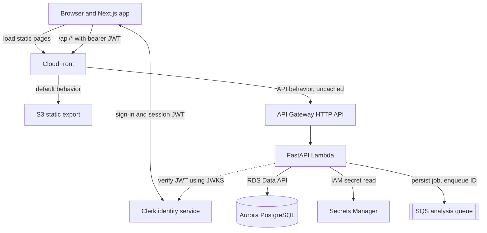
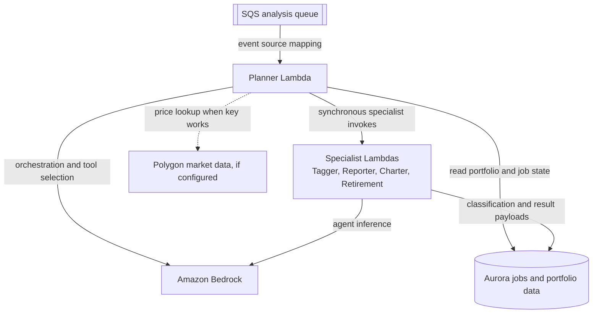
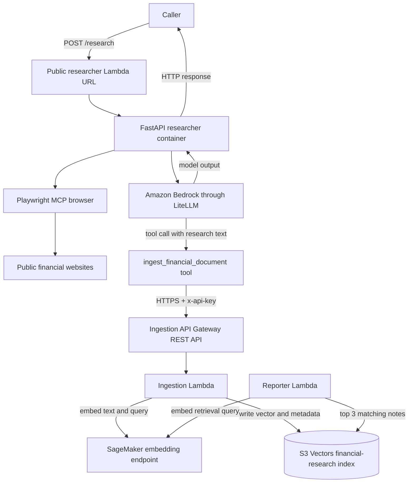

# System architecture

## At a glance

The system has two related but separate user-facing workflows:

1. **Portfolio workflow:** Clerk-authenticated user manages a portfolio and requests an analysis. The API writes an analysis job to Aurora, sends its ID to SQS, and the planner coordinates specialist Lambdas. The specialists save their outputs to the same job record.
2. **Research workflow:** A separate researcher endpoint browses public financial pages, asks Bedrock to summarize the findings, then calls an API-key-protected ingestion endpoint. Ingestion creates an embedding through SageMaker and stores the text and vector in S3 Vectors. The portfolio reporter can retrieve a few relevant research notes.

The architecture is split into three small diagrams: the authenticated app path, the asynchronous agent flow, and the separate research/retrieval flow. This keeps the main service connections visible without crossing dozens of lines in one picture.

## App and authenticated API path

## Asynchronous agent workflow

### What happens in order

1. The static app loads from S3 through CloudFront. The `/api/*` CloudFront behavior forwards requests to API Gateway and disables caching. A CloudFront Function rewrites clean static paths (for example, `/dashboard`) to exported HTML files; it does not run on the API behavior.
2. Clerk signs users in in the browser. The frontend obtains a Clerk session JWT and sends it as `Authorization: Bearer <token>` on API calls.
3. API Gateway forwards `/api/*` requests to the FastAPI Lambda. Gateway does not have a JWT authorizer: FastAPI validates the JWT using Clerk's JWKS URL and derives the user identity from the verified `sub` claim.
4. FastAPI performs the requested CRUD operation or creates a `jobs` row with `pending` status. For analysis it sends the job ID and request context to SQS, then returns the job ID to the browser.
5. SQS invokes the planner Lambda. The planner marks the job `running`, finds instruments with missing allocation data, updates prices where possible, loads a portfolio summary, and runs the planner agent.
6. The planner invokes Tagger when instruments need classification. It invokes Reporter, Charter, and Retirement as specialist Lambdas. The model-driven planner coordinates tool calls; do not describe their invocation as guaranteed parallel execution.
7. Specialists write report, chart, or retirement JSON into fields on the same Aurora job record. The planner marks the job `completed`; failures are recorded as `failed` with an error message. The UI polls job status and displays the resulting payloads.

## Research and knowledge-base workflow

The researcher runs in a Docker-image Lambda built with Playwright dependencies. Its `/research` endpoint accepts an optional `topic`. If omitted, the model chooses a current topic. The agent is instructed to browse no more than two pages, write a short analysis, and call the ingestion tool. The tool sends text and topic metadata to the ingestion API, which uses SageMaker to embed the text and S3 Vectors to store it. The Reporter can embed a portfolio-related query and retrieve up to three matching research records.

The S3 Vectors bucket/index is a separate AWS resource type from the ordinary S3 bucket also named `alex-vectors-635863384208`. The ordinary bucket is managed by the ingestion Terraform stack; the deployed `financial-research` vector index pre-existed and was reused. The ingestion stack does not create that vector index.

## Service-to-service communication

| Caller | Callee | Protocol / identity | Purpose |
|---|---|---|---|
| Browser | Clerk | Clerk JS and session JWT | Sign-in and token acquisition |
| Browser | CloudFront | HTTPS | Static app and same-origin `/api/*` proxy |
| CloudFront | S3 website origin | HTTP from CloudFront to website origin | Static Next.js export |
| CloudFront | API Gateway | HTTPS, forwards auth header and cookies | API requests |
| API Gateway | API Lambda | AWS Lambda proxy integration | FastAPI routes |
| API Lambda | Clerk JWKS | HTTPS | Validate JWT signature and claims |
| API / agent Lambdas | Aurora Data API | AWS SDK, IAM, Secrets Manager reference | SQL without direct database socket connections |
| API Lambda | SQS | AWS SDK, IAM | Enqueue analysis job |
| SQS | Planner Lambda | Lambda event source mapping | Start async analysis |
| Planner Lambda | specialist Lambdas | synchronous `InvokeFunction`, IAM | Execute specialist tasks |
| Agent Lambdas | Bedrock | AWS SDK/LiteLLM using Lambda IAM role | LLM inference |
| Reporter / ingestion | SageMaker endpoint | AWS SDK, IAM | Text embedding |
| Reporter / ingestion | S3 Vectors | AWS SDK, IAM | Search or store vectors |
| Researcher Lambda | ingestion API | HTTPS + API key in `x-api-key` | Store research result |
| Lambda functions | CloudWatch Logs | Lambda execution role | Runtime logs |

There is no direct VPC database connection from these Lambdas. Application code calls the RDS Data API; that API uses the Aurora cluster ARN and the database credential secret.

## Terraform deployment layers

Each directory has a separate local Terraform state. The numeric names reflect the project's tutorial progression, not a single Terraform root module.

| Stack | Main responsibility | Dependency notes |
|---|---|---|
| `2_sagemaker` | Serverless SageMaker embedding endpoint | Used by ingestion and Reporter |
| `3_ingestion` | Ingestion Lambda, REST API key/usage plan, standard S3 bucket and IAM | Uses endpoint from stack 2; vector index itself is external/pre-existing |
| `4_researcher` | ECR image, public Lambda Function URL, Bedrock IAM, optional scheduler | Uses ingestion endpoint/key; current schedule is disabled |
| `5_database` | Aurora Serverless v2, Secrets Manager secret, Data API and IAM | Shared database foundation |
| `6_agents` | SQS, DLQ, planner and four specialist Lambdas, CloudWatch log groups | Uses database, SageMaker and vector configuration |
| `7_frontend` | S3 static site, CloudFront, API Gateway HTTP API and FastAPI Lambda | Reads local state outputs from stacks 5 and 6 |
| `8_enterprise` | CloudWatch AI-usage and agent-performance dashboards | Monitors Bedrock, SageMaker, and Lambda metrics |

Practical deployment order: `2`, `3`, and `5`; then `6`; then `4` and `7`; then `8`. Stack 7 reads the local state files for stacks 5 and 6, so those state files must be available on the same machine. The researcher deployment's exact model and optional image override come from its current Terraform variables and local tfvars, not older README defaults.
